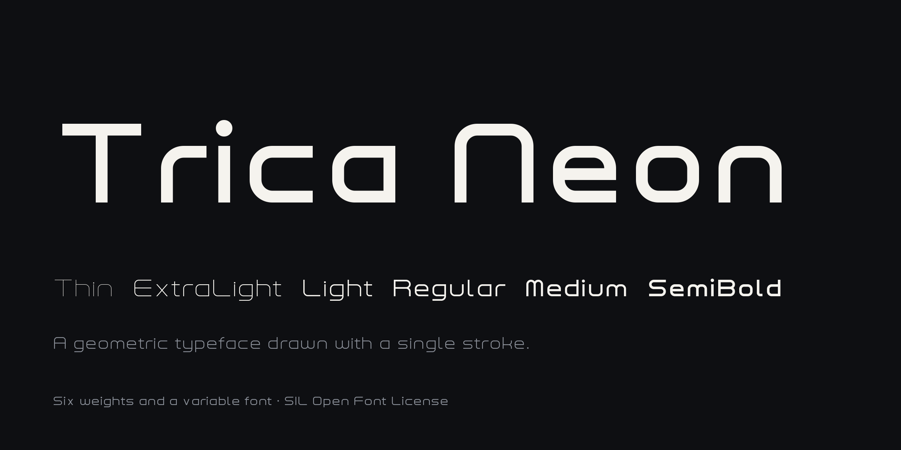
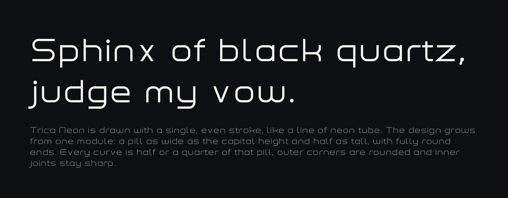
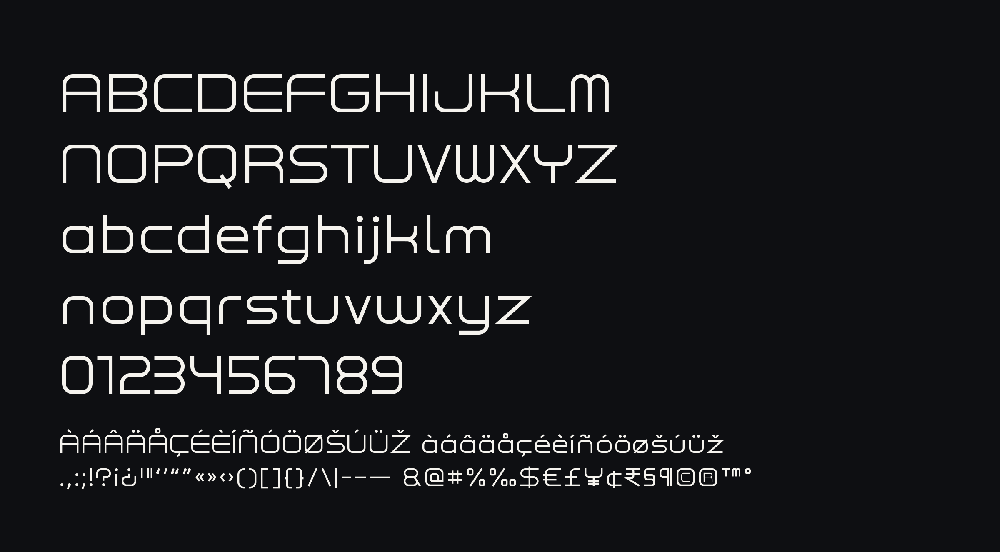
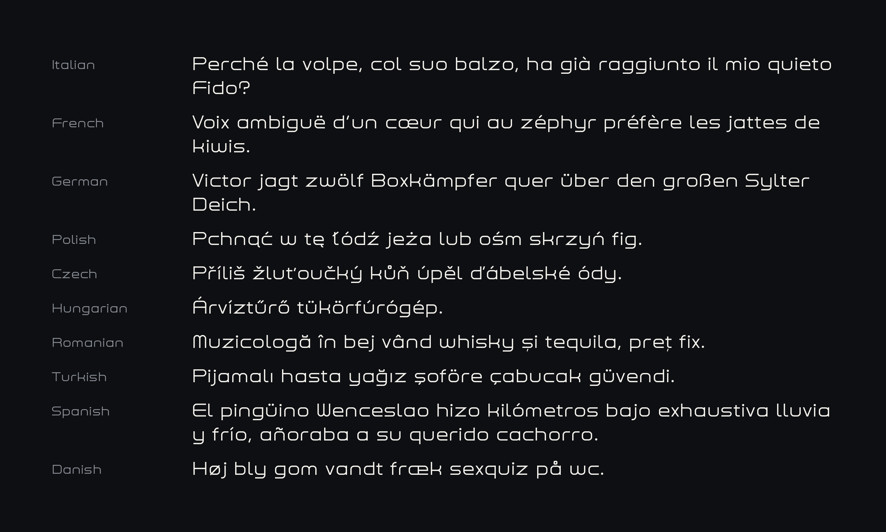

# Trica Neon



Trica Neon is a geometric display typeface drawn with a single, even stroke, like a line of neon tube. The design grows from one module: a pill as wide as the capital height and half as tall, with fully round ends. Every curve is half or a quarter of that pill, outer corners are rounded and inner joints stay sharp.

It is made for headlines, titles and logos, for posters, signs and interfaces, and it feels at home in short texts such as captions, labels and menus. For long reading, it pairs well with a quieter text face.

[Specimen page](https://tricaman.github.io/trica-neon/) · [Download](https://github.com/tricaman/trica-neon/releases/latest)

## Styles

Six weights, as static fonts and as one variable font with a weight axis from 100 to 600: Thin, ExtraLight, Light, Regular, Medium and SemiBold.



## Character set



Trica Neon covers the [GF Latin Core](https://github.com/googlefonts/glyphsets) character set of Google Fonts, which includes these ten languages among many others:



OpenType features: kerning, mark positioning (`mark`, `mkmk`), `ccmp`, Romanian and Moldovan forms (`locl`), fractions (`frac`, `numr`, `dnom`), superiors (`sups`), ordinals (`ordn`), tabular figures (`tnum`) and case-sensitive brackets (`case`).

## Installation

### Desktop

Download the zip of the [latest release](https://github.com/tricaman/trica-neon/releases/latest) and unzip it. The static fonts are in `fonts/otf` and `fonts/ttf`, the variable font in `fonts/variable`.

- **macOS**: open the font files and click *Install* in Font Book.
- **Windows**: select the font files, right-click them and choose *Install*, or *Install for all users*.
- **Linux**: copy the font files to `~/.local/share/fonts` and run `fc-cache -f`.

### Web

Host the WOFF2 files from `fonts/webfonts`. The variable font covers every weight with one file:

```css
@font-face {
  font-family: "Trica Neon";
  src: url("TricaNeon[wght].woff2") format("woff2");
  font-weight: 100 600;
  font-display: swap;
}
body {
  font-family: "Trica Neon", sans-serif;
}
```

The OpenType features work with the usual CSS properties, such as `font-variant-numeric: tabular-nums` or `font-variant-numeric: diagonal-fractions`.

## Build

A Python generator in `sources/generator/` draws every glyph from centerline skeletons and writes the UFO sources: one master per weight, from Thin to SemiBold, and `sources/TricaNeon.designspace`. The UFOs are generated files: change the generator, not the UFOs. [gftools builder](https://github.com/googlefonts/gftools) then compiles them as set in `sources/config.yaml`. With Python 3.13 installed:

```sh
make build           # every font from scratch, starting from the generator
make sources         # only regenerate the UFO masters and the designspace
make check-sources   # fail if the UFOs in the repository differ from the generator
make test            # FontBakery with the Google Fonts profile; reports in out/fontbakery
make proof           # HTML proof and PNG specimen in out/proof
make specimen        # the specimen page in out/specimen, ready for GitHub Pages
make images          # the images of this README in documentation/images
make npm             # npm package with the web fonts and ready-made CSS in out/npm
make release         # zip of the fonts, the license and this README
```

`make build` writes the variable font to `fonts/variable`, the static fonts to `fonts/ttf` and `fonts/otf` and the WOFF2 web fonts to `fonts/webfonts`. GitHub Actions builds and checks the fonts on every push; a tag with the font version, such as `1.000`, also publishes a GitHub release with the zip.

## License

Trica Neon is licensed under the SIL Open Font License, Version 1.1. The license is in [OFL.txt](OFL.txt) and is also available with a FAQ at https://openfontlicense.org.
